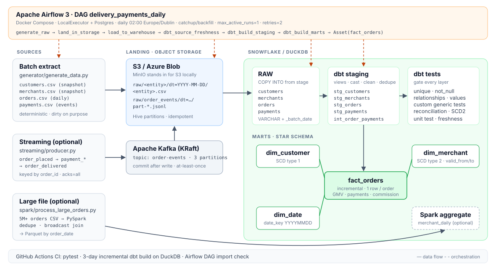
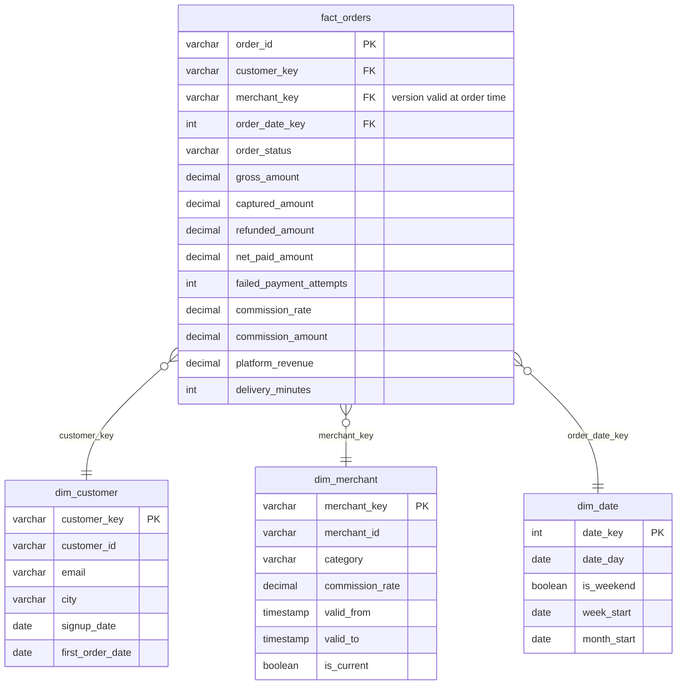

# Delivery & Payments Data Pipeline

An end-to-end ELT pipeline for a food-delivery marketplace: order and payment data is extracted daily, landed in object storage, loaded into a cloud warehouse, modelled with **dbt** into a tested **star schema**, and orchestrated by **Airflow**. Optional extras process a multi-million-row file with **PySpark** and stream live order events through **Kafka**.

Everything runs on a laptop with Docker (MinIO stands in for S3, DuckDB for Snowflake), and the same code points at real **AWS S3 / Azure Blob** and **Snowflake** by changing environment variables.



| Layer | Tool | Where |
|---|---|---|
| Source extract | Python (deterministic synthetic data) | `generator/` |
| Landing zone | S3 / Azure Blob (MinIO locally) | `ingestion/upload_to_storage.py` |
| Warehouse load | Snowflake `COPY INTO` from external stage (DuckDB locally) | `ingestion/load_warehouse.py`, `warehouse/snowflake_setup.sql` |
| Transform + test | dbt Core 1.11+ | `dbt/` |
| Orchestration | Airflow 3 in Docker Compose | `airflow/`, `docker-compose.yml` |
| Large-file batch | PySpark 3.5+/4.x | `spark/` |
| Streaming | Kafka (KRaft) producer + lake-writer consumer | `streaming/` |
| CI | GitHub Actions | `.github/workflows/ci.yml` |

---

## Quick start

### Option A: no Docker (2 minutes)

```bash
python -m venv .venv && source .venv/bin/activate
make install
make local-run START=2026-10-04 DAYS=6   # generate -> load DuckDB -> dbt build, one day at a time
make test                                # Python unit tests
make dbt-docs                            # lineage graph at http://localhost:8081
```

Each day runs the real incremental path, so after six days you have ~12k orders, ~13k payment events and a merchant dimension with genuine SCD2 history. Query it:

```bash
duckdb warehouse/delivery.duckdb
```
```sql
select d.date_day, count(*) orders, sum(f.gross_amount) gmv, sum(f.platform_revenue) platform_revenue
from analytics_marts.fact_orders f
join analytics_marts.dim_date d on f.order_date_key = d.date_key
group by 1 order by 1;
```

### Option B: full stack in Docker

```bash
cp .env.example .env
make up            # Airflow + Postgres + MinIO, builds the image on first run
```

* Airflow UI: <http://localhost:8080> (local dev mode, no login). The DAG `delivery_payments_daily` is unpaused and catches up from 1 Oct 2026, one run per day, in order.
* MinIO console: <http://localhost:9001> (`minioadmin` / `minioadmin`). Watch `delivery-lake/raw/<entity>/dt=…/` fill up.
* Backfill a range explicitly: `docker compose exec airflow airflow backfill create --dag-id delivery_payments_daily --from-date 2026-09-01 --to-date 2026-09-07`

`make down` stops everything.

---

## Data model



**Grain:** `fact_orders` has one row per order. Payment events (attempts, captures, refunds) are rolled up per order in `int_order_payments` first, so the fact never fans out.

**dbt layers**

| Layer | Materialisation | Job |
|---|---|---|
| `staging/stg_*` | view | cast VARCHAR raw columns, clean (e-mail case/whitespace), dedupe (re-delivered files, webhook retries) |
| `intermediate/int_order_payments` | view | payment event stream → one row per order |
| `marts/dim_*` | table | conformed dimensions; `dim_merchant` is SCD type 2 |
| `marts/fact_orders` | **incremental** (`delete+insert` on `order_id`) | re-processes a 3-day lookback so late refunds update the original order |

---

## Data quality

The generator deliberately produces the kinds of problems real sources have, and the pipeline is tested against them:

| Problem in raw data | Handled in | Proven by |
|---|---|---|
| Duplicate payment events (gateway webhook retries) | `stg_payments` dedupe | `unique` on `payment_id`; unit test |
| Declined attempt then successful retry | `int_order_payments` | unit test counts `failed_attempts` |
| Refunds as separate negative rows, sometimes next day | rollup + incremental lookback | `assert_payments_match_order_status` |
| E-mails with whitespace / upper case | `stg_customers` | custom generic test `is_clean_email` |
| Merchant commission changes over time | SCD2 `dim_merchant` | `assert_merchant_versions_do_not_overlap` |
| A file re-delivered or a task retried | idempotent partition loads | `test_duckdb_load_is_idempotent`; `assert_no_orders_lost_between_layers` |

**61 dbt tests run on every build** (60 data tests + 1 unit test): `unique`, `not_null`, `relationships` (fact → every dimension), `accepted_values`, four custom generic tests in `macros/generic_tests.sql` (`non_negative`, `in_range`, `is_clean_email`, `unique_combination`), four singular reconciliation tests in `dbt/tests/`, the dbt **unit test** on the payment rollup, plus **source freshness** on `_loaded_at`.

Because Airflow runs `dbt build` (models + tests together, layer by layer), a failing check stops the run before bad data reaches the marts. Try it: corrupt a raw row and rebuild; the failing test is named and everything downstream is skipped.

---

## Running against real cloud services

### Snowflake + S3 (both have free tiers / trials)

1. **S3:** create a bucket and an IAM role Snowflake can assume (read access to `s3://<bucket>/raw/`).
2. **Snowflake:** fill in the `<...>` placeholders and run `warehouse/snowflake_setup.sql` as `ACCOUNTADMIN`. It creates the warehouse, database, `TRANSFORMER` role, storage integration, external stage, file format and the four RAW tables. Run `DESC INTEGRATION S3_LAKE_INT` and paste the IAM user ARN and external ID into the role's trust policy.
3. In `.env`:
   ```ini
   STORAGE_BACKEND=s3
   S3_BUCKET=<your-bucket>
   S3_ENDPOINT_URL=              # empty = real AWS
   AWS_ACCESS_KEY_ID=...
   AWS_SECRET_ACCESS_KEY=...
   WAREHOUSE=snowflake
   DBT_TARGET=snowflake
   SNOWFLAKE_ACCOUNT=... SNOWFLAKE_USER=PIPELINE_USER SNOWFLAKE_PASSWORD=...
   ```
4. `make up`. The loader now runs `DELETE` + `COPY INTO … FROM @RAW.LAKE_STAGE/raw/<entity>/dt=<date>/` per entity, and dbt builds into `ANALYTICS_STAGING` / `ANALYTICS_MARTS`.

The dbt SQL is warehouse-neutral; the two places that differ (date spine, ISO weekday) use `adapter.dispatch` with a Snowflake implementation.

### Azure Blob instead of S3

Set `STORAGE_BACKEND=azure` and `AZURE_STORAGE_CONNECTION_STRING`, and use the commented Azure storage integration in `snowflake_setup.sql`.

---

## Optional: PySpark on a large file

```bash
pip install pyspark            # needs Java 17+
make spark                     # 5M-row CSV -> clean -> aggregate -> Parquet -> DuckDB
```

`spark/process_large_orders.py` reads with an explicit schema (no `inferSchema` pass over a big file), drops malformed rows and duplicate `order_id`s, broadcast-joins the small merchant table, and writes `merchant_daily` and `city_hourly` aggregates as Parquet partitioned by `order_date` with dynamic partition overwrite (reruns replace only their own days). On a 2-core machine, generating and processing 2M rows takes about two minutes.

## Optional: Kafka streaming

```bash
make up && make stream
docker compose logs -f event-consumer
```

The producer emits `order_placed → payment_failed? → payment_captured → order_delivered` (or `order_cancelled`) keyed by `order_id`, so each order's events stay ordered on one partition. The consumer micro-batches them to `raw/order_events/dt=…/part-*.jsonl` in the same bucket and **commits offsets only after the write succeeds** (at-least-once; downstream dedupes on `event_id`).

---

## Project layout

```
├── airflow/
│   ├── dags/delivery_payments_daily.py   # the DAG
│   ├── Dockerfile                        # Airflow 3 + pipeline libs; dbt in its own venv
│   └── requirements-airflow.txt
├── dbt/
│   ├── models/staging/                   # sources, stg_* views, tests
│   ├── models/intermediate/              # int_order_payments + unit test
│   ├── models/marts/                     # fact_orders, dim_customer, dim_merchant, dim_date
│   ├── macros/                           # generic tests, surrogate keys, dispatch helpers
│   ├── tests/                            # singular reconciliation tests
│   └── profiles.yml                      # duckdb + snowflake targets, env-var driven
├── generator/generate_data.py            # synthetic source data
├── ingestion/                            # upload to S3/Blob, load to Snowflake/DuckDB
├── spark/process_large_orders.py
├── streaming/producer.py, consumer.py
├── warehouse/snowflake_setup.sql
├── tests/test_pipeline.py                # pytest
├── docs/architecture.svg
├── docker-compose.yml  Makefile  .env.example
```

## Design decisions

* **ELT, raw as VARCHAR.** The landing tables keep exactly what the source sent plus `_batch_date`, `_source_file`, `_loaded_at`. Types are applied in dbt, so a bad value fails a test instead of a load, and every transformation is versioned SQL.
* **Idempotent by partition.** Files land at `raw/<entity>/dt=<date>/`, and loads delete-then-insert the batch date. Retries, reruns and backfills give the same result.
* **SCD2 from snapshots, not `dbt snapshot`.** Merchants arrive as daily full snapshots; versions are derived with window functions over the raw history, so the dimension can be rebuilt from scratch at any time. (`dbt snapshot` is the right tool when the source keeps no history.)
* **Facts join the dimension version valid at order time**, so a commission change on 7 Oct doesn't rewrite revenue for 6 Oct.
* **dbt in its own virtualenv** inside the Airflow image, so dbt and Airflow dependency pins never conflict.
* **No dbt packages.** The handful of tests that usually come from `dbt_utils` are written in `macros/`, so the project builds offline and CI needs no `dbt deps`.

## What I'd add next

* Load `raw/order_events` with Snowpipe (auto-ingest on S3 events) and model a near-real-time order-status table.
* `dbt-expectations`-style distribution tests (e.g. daily order volume within ±3σ) with `severity: warn`.
* Slim CI (`dbt build --select state:modified+`) against a Snowflake dev schema.
* Terraform for the bucket, IAM role and Snowflake objects.
